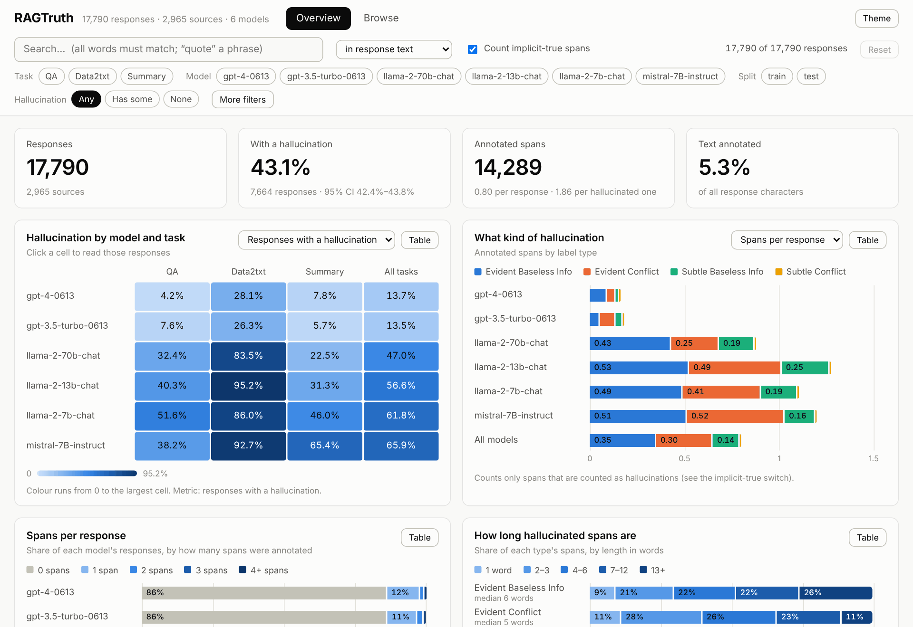
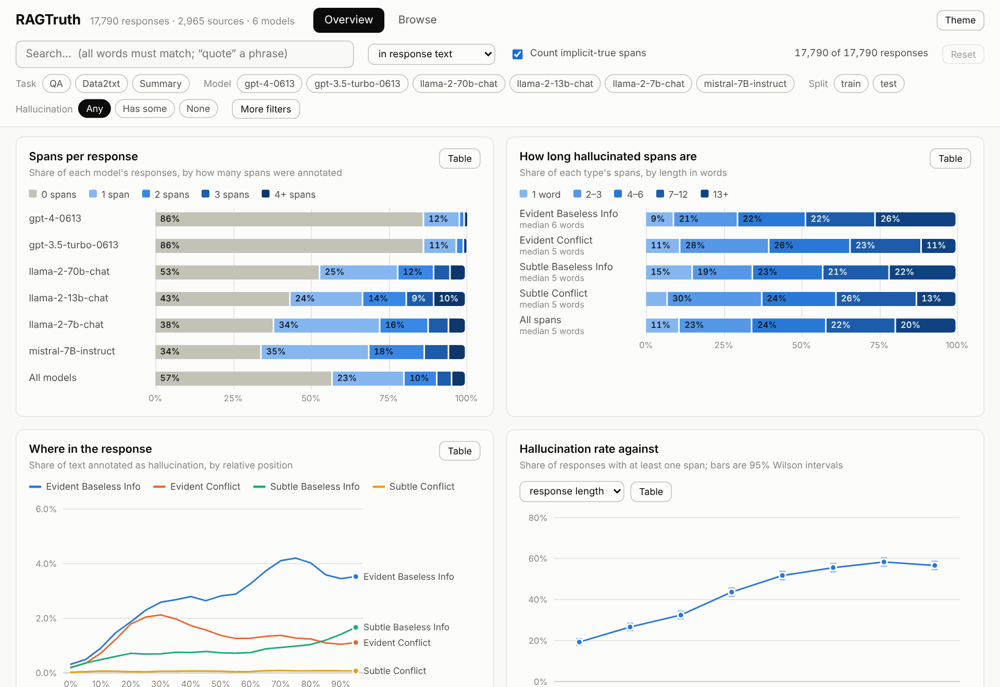
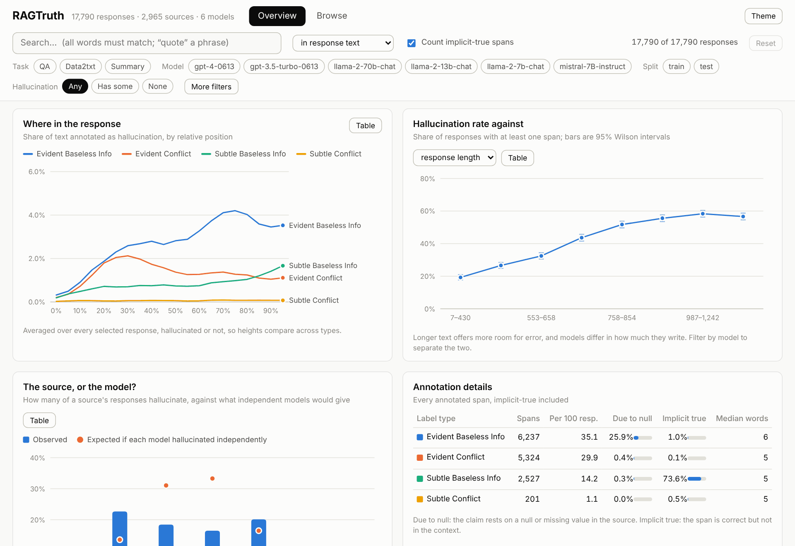
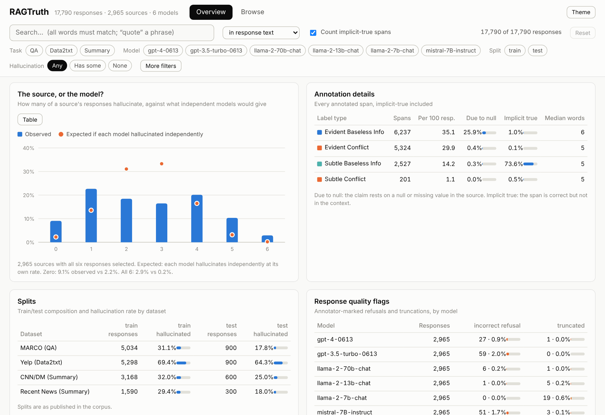
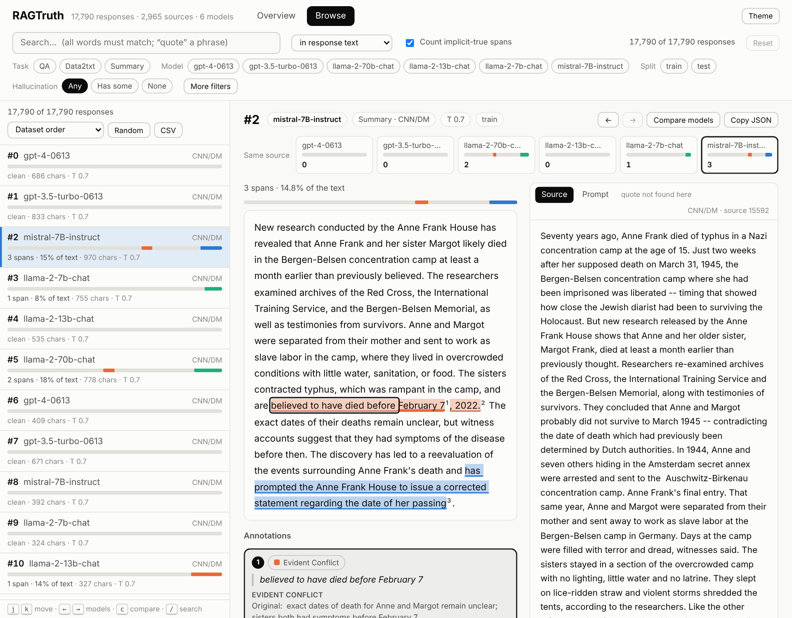
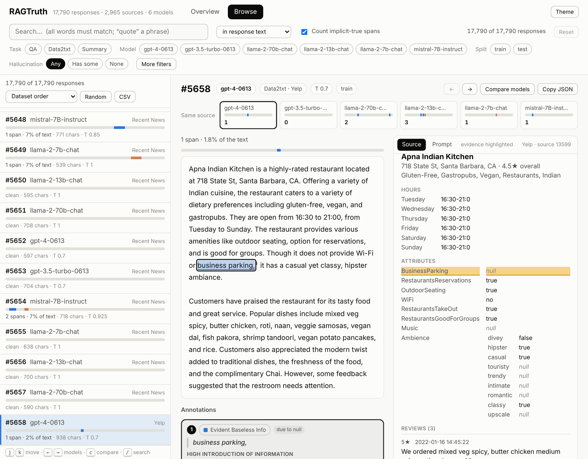
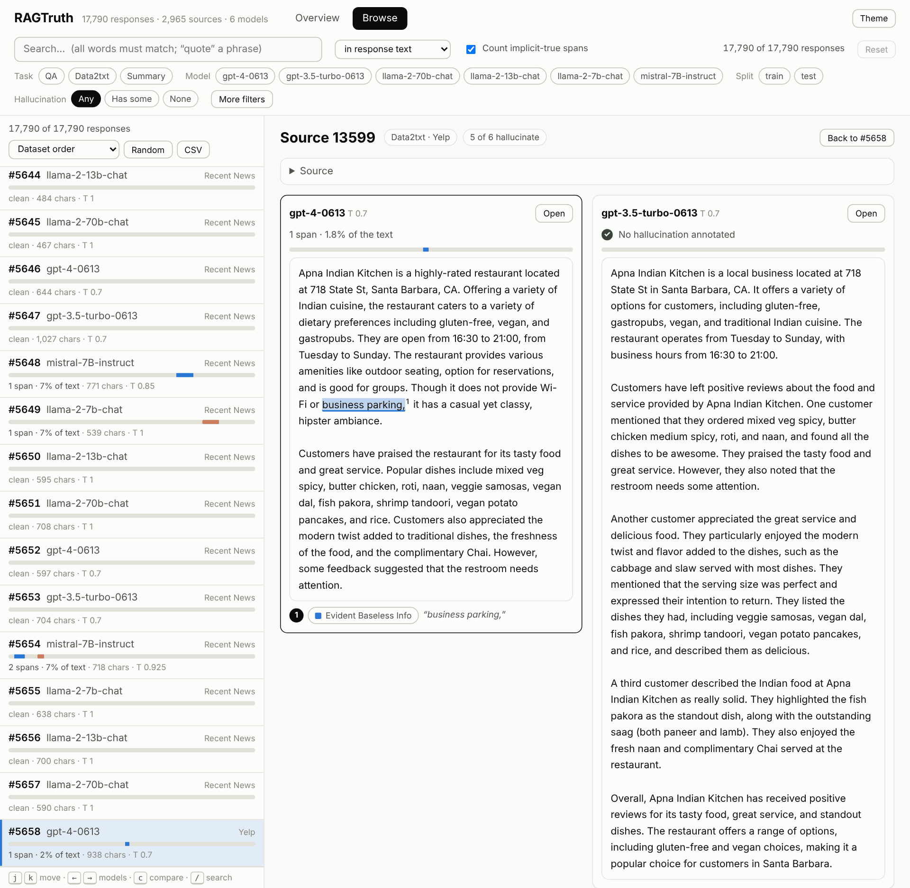
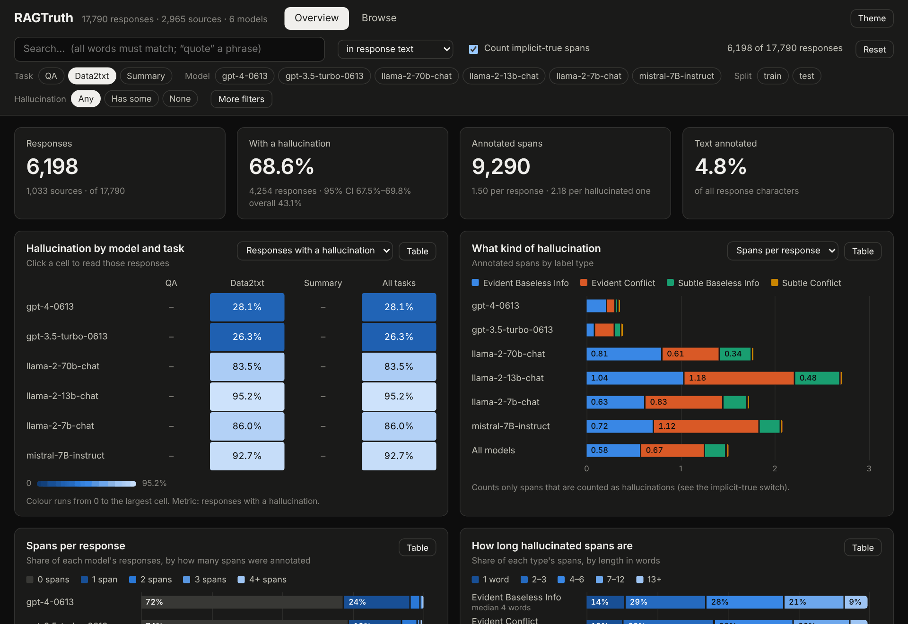

# RAGTruth viewer

**Read, search and chart the [RAGTruth](https://github.com/ParticleMedia/RAGTruth) hallucination dataset in your browser.** See every response with its hallucinated spans highlighted next to the source it was generated from, and see the patterns across all 17,790 responses.



It is one Python script (standard library only) that serves a local web page. There is nothing to install.

## Why this exists

RAGTruth is a public collection of LLM answers to retrieval-augmented prompts, in which human annotators marked the exact words that the source does not support. It ships as two JSONL files, and each hallucination is a pair of character offsets into a response. That is a good format for training and evaluating hallucination detectors, and a poor one for *reading*. Reading is how you build intuition: what do annotators actually flag? How subtle are the "subtle" cases? Do all models go wrong in the same places, on the same sources?

This viewer exists to answer those questions by looking.

## Quick start

```bash
git clone https://github.com/pmilovanov/ragtruth-viewer
cd ragtruth-viewer
python3 serve.py --download     # first run only: fetches the dataset (~36 MB)
```

Then open <http://127.0.0.1:8765/>. Next time, just `python3 serve.py`.

- You need Python 3 (developed on 3.13) and a modern browser. No `pip install`, no `npm install`, no build step.
- The dataset is not bundled. `--download` fetches `response.jsonl` and `source_info.jsonl` from the official [ParticleMedia/RAGTruth](https://github.com/ParticleMedia/RAGTruth) repository into `./data/` (git-ignored). If you already have the two files, use `python3 serve.py --data-dir /path/to/them`.
- It runs on your machine only: it listens on `127.0.0.1` by default, and the page loads nothing from the internet. The one-time download is the only network access.
- Prefer [just](https://github.com/casey/just)? `just run --download` the first time, then `just run`. `just test` runs the tests.

## A two-minute primer on RAGTruth

In retrieval-augmented generation (RAG), a model answers using text it is handed. RAGTruth asks: *when it does, does it stay faithful to that text?* Six LLMs each answered every prompt, and annotators marked the spans of each answer that are not supported by, or contradict, the source.

| | |
|---|---|
| **Size** | 17,790 responses = 2,965 prompts × 6 models |
| **Models** | GPT-4 (0613), GPT-3.5-turbo (0613), Llama-2-chat 7B / 13B / 70B, Mistral-7B-Instruct |
| **Tasks** | **Question answering** (989 prompts: MS MARCO questions, three retrieved passages each), **data-to-text** (1,033: write an overview of a Yelp business from its structured record and reviews), **summarisation** (943: CNN/Daily Mail 628, recent news 315) |
| **Annotations** | 14,289 hallucinated spans across 7,664 responses (43.1% of all responses) |
| **Split** | 15,090 train and 2,700 test responses (900 per task) |

Because every prompt is answered by all six models, you can compare how different models treat the *same* source. The viewer is built around that.

**The four kinds of hallucinated span** (paraphrasing §3.1 of the [paper](https://arxiv.org/abs/2401.00396); read it for the full definitions and examples):

| Label type | Spans | In short |
|---|---:|---|
| **Evident Baseless Info** | 6,237 | Adds information the source does not support: invented details. |
| **Evident Conflict** | 5,324 | Directly contradicts the source: wrong numbers, wrong names, clear factual errors. |
| **Subtle Baseless Info** | 2,527 | Goes beyond the source with inferred details, insights or sentiments, such as assumptions or "commonly observed norms". |
| **Subtle Conflict** | 201 | Departs from the source in a way that shifts its meaning, such as swapping in a term with different implications. |

Each span can also carry two flags, and each response a quality label:

- `due_to_null`: the hallucination was caused by a null or missing value in the source (in this corpus it occurs only in data-to-text).
- `implicit_true`: the span is actually *correct*, but the information is not in the source.
- `quality`: `good`, `incorrect_refusal` (the model refused although the answer was in the context) or `truncated`.

Annotators also leave a free-text note on almost every span, often quoting the source next to the generated claim. The viewer shows these too.

## Tour

### Overview: patterns across the corpus

Everything on this page is computed from whatever the filter bar currently selects, so the numbers always agree with each other. Every chart has a **Table** button that shows the same numbers as a table.

| Chart | The question it answers |
|---|---|
| Model × task heatmap | Which models hallucinate, on which tasks? (Click a cell to read those responses.) |
| What kind of hallucination | Which of the four label types does each model produce? |
| Spans per response | Is it usually one slip, or several? |
| How long hallucinated spans are | A word or two, or whole sentences? |
| Where in the response | Do different label types cluster early or late? |
| Hallucination rate against… | How does the rate move with response length, prompt length or temperature? |
| The source, or the model? | Are some *sources* intrinsically harder, beyond what the models' own error rates explain? |







**A few things you will see** (default settings; "with a hallucination" means at least one labelled span):

- **Model and task matter a great deal.** GPT-4 and GPT-3.5-turbo have a labelled span in 13.7% and 13.5% of their responses; the open models in 47.0% (Llama-2-70B) to 65.9% (Mistral-7B). Yelp data-to-text is the hardest task for everyone: 28.1% and 26.3% for the two GPT models, 83.5% to 95.2% for the open ones.
- **Label types fail in different places.** Evident Baseless Info peaks about 75–80% of the way through a response, Evident Conflict about a third of the way in (30–35%), and Subtle Baseless Info keeps climbing to the very end.
- **Longer responses are flagged more often**: 19.3% for the shortest eighth of responses against 56.7% for the longest. Length is tangled up with model and task, though, so filter by model before reading much into it.
- **Some sources are just hard.** 9.1% of sources have *none* of their six responses flagged, against 2.2% if each model failed independently at its own rate; 2.9% have *all six* flagged, against 0.2%.
- **The flags are lopsided.** 73.6% of Subtle Baseless Info spans are `implicit_true` (correct, but not in the source), and `due_to_null` is concentrated in Evident Baseless Info (25.9% of its spans).

### Browse: read individual responses



- **The list** (left) shows each response with a minimap of where its spans fall. Sort by span count, share of text annotated or length; **Random** jumps to a random one; **CSV** exports the filtered list.
- **The response** (middle) has spans highlighted by label type. Overlapping spans are drawn as stacked underlines, not lost. Below it, every span is listed with its type, flags and the annotator's note. The strip of six pills shows how the other models fared on the same source; click one to jump to it.
- **The source and the prompt** (right) are always one click away, so you can check a claim against the text it was supposed to follow.

**Evidence linking.** Select an annotation and, where the annotator quoted the source (`Original: …`), that text is highlighted in the source panel and scrolled into view. For data-to-text, the notes mostly quote the JSON (`"BusinessParking": null`), and the viewer highlights the matching key/value row:



This is best-effort: annotators often paraphrase. On the published data it locates roughly a third of the quotes in summaries, a seventh in QA and nearly two-thirds in data-to-text. When it cannot find one, it says so and does not guess.

**Compare models.** Press `c` (or **Compare models**) to see all six answers to one source side by side:



**Filters and search** scope both pages at once: task, model, split, whether a response has any hallucination, label type, dataset, quality, temperature, and full-text search over the response, the hallucinated spans, the annotators' notes or the source. Everything is reflected in the URL.

Light and dark themes are both supported (`t` toggles):



## Try this

1. On **Overview**, click the Llama-2-13B × Data2txt cell (95.2%). **Browse** opens on exactly those responses.
2. Press `c` on any response to see how all six models handled the same source.
3. Open response `5658` (a Yelp business), select its "due to null" annotation, and watch the null field light up in the source.
4. Search for `Gaza Strip`. The first hit, response `1472`, is the example in RAGTruth's own README.
5. Untick **Count implicit-true spans** and watch the overall rate fall from 43.1% to 39.4%.

## How the viewer counts things

- A response **has a hallucination** if it has at least one labelled span. By default every labelled span counts, `implicit_true` ones included. That is the convention behind the statistics table in the [upstream README](https://github.com/ParticleMedia/RAGTruth#data-statistics), and the viewer reproduces that table exactly (an automated test checks it whenever the data is present). Untick **Count implicit-true spans** to treat those spans as supported instead; every number and chart follows.
- **Text annotated** is the share of response characters inside at least one span. Overlapping spans are counted once.
- **Has label type** selects responses containing at least one span of that type; the charts then count *all* spans in those responses.
- The rates are **descriptions of this corpus, not a leaderboard**. There is one prompt template per task, the GPT models were sampled at temperature 0.7, the open models at five temperatures between 0.7 and 1.0, and the labels are human judgements. Confidence intervals are Wilson 95% intervals over responses; they treat responses as independent even though six share each source.
- **The source, or the model?** works out, for each model, its own hallucination rate, then asks how many of a source's six responses would be flagged if each model failed independently at that rate. The gap between that and what happened is the signal that sources differ. It only makes sense if the filters do not remove responses *because* they hallucinated, so it switches itself off while the hallucination or label-type filter is set.

## Use it for your own analysis

- **CSV.** The CSV button in Browse exports the filtered list (`id`, `source_id`, `model`, `task`, `dataset`, `split`, `temperature`, `quality`, `n_spans`, `hallucinated_chars`, `response_chars`). Join it to RAGTruth's own files on `id`. The span counts follow the implicit-true switch.
- **Links.** The filters and the response you are looking at live in the URL hash, e.g. `http://127.0.0.1:8765/#/browse/1472?model=mistral-7B-instruct`. (The link opens on any machine that runs the viewer.)
- **As a library.** `rtdata.py` has no web dependencies:

```python
from pathlib import Path
import rtdata

ds = rtdata.Dataset.load(Path("data"))
hits = ds.search("gaza strip")      # row indices; scope= "response", "spans", "notes" or "source"
r = ds.response_detail(ds.responses[hits[0]]["id"])
print(r["id"], r["model"], [(l["type"], l["text"]) for l in r["labels"]])
# 1472 mistral-7B-instruct [('Evident Baseless Info', 'Gaza Strip')]
```

## Keyboard shortcuts

`j` / `k` next / previous response · `←` / `→` previous / next model on the same source · `c` compare · `/` search · `1` / `2` Overview / Browse · `t` theme · `Esc` leave a field

## Development

```bash
python3 -m unittest discover -s tests    # loader, index, search, HTTP; real-corpus checks run if ./data is present
node --test                              # span segmentation, evidence matching, selection logic, URL state
```

```
  serve.py        HTTP server and CLI (stdlib http.server)
  rtdata.py       load, columnar index, record lookup, search
  static/         index.html, style.css, js/ (ES modules, hand-rolled SVG and HTML charts)
  tests/          unittest (Python) and node:test (JS)
  docs/images/    the screenshots above
  justfile        just run, just test
  data/           the dataset, fetched by --download (git-ignored)
```

The server sends the browser one ~190 KB gzipped, column-oriented index (everything except the bulky text). The browser does all the aggregating and cross-filtering itself, so charts redraw in tens of milliseconds; response and source text are fetched per record on demand. Tested in Chromium, with Python 3.13 and Node 22; other combinations are untried. The viewer was first built in [`pmilovanov/guardrails`](https://github.com/pmilovanov/guardrails) under `data/ragtruth/ui/`.

## Credits and citation

RAGTruth was created by Yuanhao Wu, Juno Zhu, Siliang Xu, Kashun Shum, Cheng Niu, Randy Zhong, Juntong Song and Tong Zhang. **This viewer is an independent tool and is not affiliated with the authors.** The dataset repository is MIT-licensed; its source documents come from MS MARCO, Yelp, CNN/Daily Mail and recent news, which may carry terms of their own. The screenshots above reproduce short excerpts of the data, for illustration.

If you use the dataset, please cite the paper:

```bibtex
@misc{wu2023ragtruth,
      title={RAGTruth: A Hallucination Corpus for Developing Trustworthy Retrieval-Augmented Language Models},
      author={Yuanhao Wu and Juno Zhu and Siliang Xu and Kashun Shum and Cheng Niu and Randy Zhong and Juntong Song and Tong Zhang},
      year={2023},
      eprint={2401.00396},
      archivePrefix={arXiv},
      primaryClass={cs.CL}
}
```
